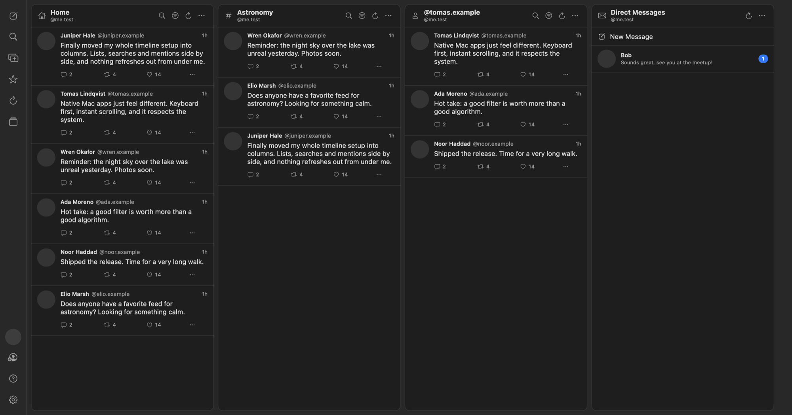

<p align="center">
  
</p>

<h1 align="center">BlueSkyship</h1>

<p align="center">
  A native macOS deck client for <a href="https://bsky.app">Bluesky</a>.<br>
  Keep your timeline, searches, feeds and messages side by side, in columns.
</p>

<p align="center">
  <a href="https://github.com/MacBachi/BlueSkyship/releases/latest"></a>
  <a href="LICENSE"></a>
  
  <a href="https://github.com/MacBachi/BlueSkyship/actions/workflows/secret-scan.yml"></a>
</p>



## Features

- **Columns:** home, notifications, mentions, searches, profiles, feeds, lists, likes, bookmarks and direct messages. Move and resize them freely, and see at a glance which columns are out of view.
- **Several decks:** switch between sets of columns with `⌘1` to `⌘9`.
- **Filters per column:** only certain words, hide words or `@handles`, only posts with media, no reposts, no replies. Filters run locally.
- **Favorites:** people, hashtags, searches, feeds and lists within reach, without taking up a column. Pin one when you want it to stay.
- **Composer:** threads, drafts, scheduled posts, up to four images, video and reply rules. Images are downscaled and stripped of metadata such as the GPS location.
- **Your own posts:** see everything you posted with reactions, and who liked, reposted or quoted it.
- **Messages:** read, answer and start direct messages.
- **Moderation:** mute, block, bookmark, translate and delete your own posts.
- **Keyboard control:** `j` `k` to move, `l` to like, `r` to reply, `1`–`9` for columns, and more.
- **Multiple accounts**, notifications on the Dock icon and optionally in macOS.
- **iCloud sync** for favorites, decks and draft text.
- **German and English**, following your system language or set by hand, with built-in help and a guided tour.
- **Native:** SwiftUI, no third-party dependencies, no analytics.

## Install

Download the latest DMG from [Releases](https://github.com/MacBachi/BlueSkyship/releases/latest). It requires macOS 14 or later.

## Sign in

1. Create an [app password](https://bsky.app/settings/app-passwords). The app opens this page for you on first sign-in.
2. Enter your name and the app password. `peter` is enough for `peter.bsky.social`. Your own domain and email addresses work too, and the app finds your server by itself.

For direct messages, turn on **Allow access to your direct messages** when you create the app password.

The password is used only to sign in and is never stored. Session tokens stay in the macOS Keychain. See [SECURITY.md](SECURITY.md).

## Keyboard shortcuts

| Shortcut | Action |
| --- | --- |
| `⌘N` | New post |
| `⌘↩` | Send post |
| `⌘T` | Add column |
| `⌘R` | Refresh all columns |
| `⌘D` | Favorites |
| `⌘F` | Search in a column |
| `⌘⇧F` | Search all of Bluesky |
| `⌘1`–`⌘9` | Switch deck |
| `⌘,` | Settings |
| `⌘?` | Help |

## Known limitations

- Scheduled posts are sent only while the app is running and the Mac is awake.
- iCloud sync uses the last change for a whole list, so simultaneous edits on two Macs can overwrite each other. Sync between two Macs has not been verified yet.
- There is no iPhone or iPad version.

## Build from source

You need Xcode and [XcodeGen](https://github.com/yonaskolb/XcodeGen). The Xcode project is generated from `project.yml`.

```bash
git clone https://github.com/MacBachi/BlueSkyship.git
cd BlueSkyship
git config core.hooksPath .githooks
xcodegen generate
open BlueSkyship.xcodeproj
```

To sign with your own Apple Developer account, see [CONTRIBUTING.md](CONTRIBUTING.md). `scripts/release.sh` builds, signs and notarizes a DMG, and its first lines list what it needs.

## Project layout

| Folder | Contents |
| --- | --- |
| `Sources/ATProto` | XRPC client with token refresh, data models, API calls, facets |
| `Sources/Deck` | Columns and their loading state, accounts, actions, iCloud sync |
| `Sources/Views` | Deck window, columns, posts, embeds, composer, dialogs, help |
| `Tests` | Unit tests and invisible UI tests against a simulated server |
| `scripts` | Release, app icon, record validation and secret checks |

## Contributing

Bug reports and pull requests are welcome. See [CONTRIBUTING.md](CONTRIBUTING.md) and [TESTING.md](TESTING.md). Please report security problems as described in [SECURITY.md](SECURITY.md).

## License

Copyright © 2026 MacBachi.

BlueSkyship is free software under the [GNU General Public License v3.0 or later](LICENSE). You may use, study, change and share it. If you distribute it or a modified version, you must make the source available under the same license.

BlueSkyship is an independent project and is not affiliated with or endorsed by Bluesky Social, PBC.
